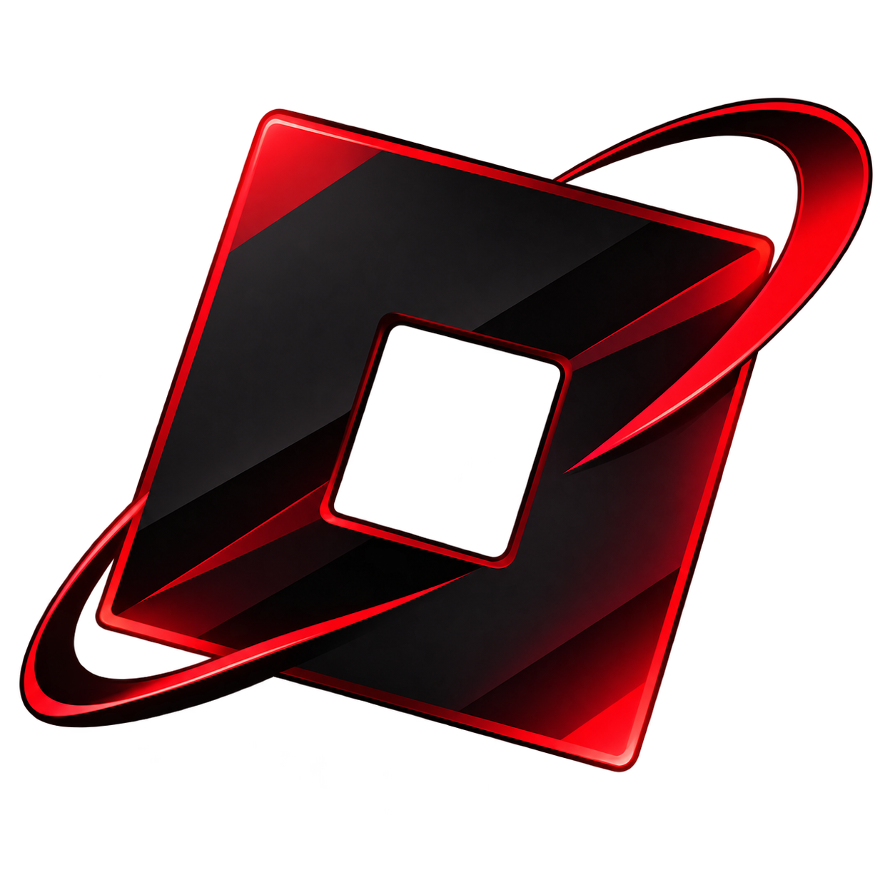

<div align="center">
  

# 🪐 NovaStrap

### The last Roblox launcher you'll ever need. **Chaos, in orbit.**

**One Windows-native command deck for Roblox — launch it, tune it, mod it, master it.**

FastFlags · Mods · Multi-instance · Rich Presence · Diagnostics — built in public, verified in CI.

Independently forged and maintained by [**xphantomcorp**](https://github.com/TheChaosManBehindAll).

<a href="https://github.com/TheChaosManBehindAll/NovaStrap/actions/workflows/build-windows.yml"></a>
<a href="https://github.com/TheChaosManBehindAll/NovaStrap/actions/workflows/ci.yml"></a>
<a href="https://github.com/TheChaosManBehindAll/NovaStrap/stargazers"></a>


[Repository](https://github.com/TheChaosManBehindAll/NovaStrap) · [Releases](https://github.com/TheChaosManBehindAll/NovaStrap/releases) · [Actions](https://github.com/TheChaosManBehindAll/NovaStrap/actions) · [Issues](https://github.com/TheChaosManBehindAll/NovaStrap/issues) · [Roadmap](#-the-roadmap) · [FAQ](#-faq)

</div>

---

> [!WARNING]
> **You are looking at a power plant under construction.** NovaStrap is in active early development (`0.2.0-dev`). There is no stable public installer yet — only CI build artifacts. Some interface elements are placeholders, and any feature not explicitly marked **live** below is *roadmap, not reality*. We hype what we ship — nothing else.

## Contents

- [📍 Project status](#-project-status)
- [✨ Why NovaStrap?](#-why-novastrap)
- [🚀 The feature deck](#-the-feature-deck)
- [🖥️ Interface overview](#-interface-overview)
- [🗺️ The roadmap](#-the-roadmap)
- [📸 Screenshots](#-screenshots)
- [💾 Get NovaStrap](#-get-novastrap)
- [🤖 Automated builds](#-automated-builds)
- [🧠 FAQ](#-faq)
- [⚙️ Under the hood](#-under-the-hood)
- [🧭 Compatibility and Roblox disclaimer](#-compatibility-and-roblox-disclaimer)
- [🐛 Reporting an issue](#-reporting-an-issue)
- [🤝 Maintainer and contributions](#-maintainer-and-contributions)
- [⚖️ License](#-license)
- [⭐ Star history](#-star-history)

## 📍 Project status

| Item | Current status |
|---|---|
| Project stage | **Early development — moving fast** |
| Project version in source | `0.2.0` |
| Maintainer | [xphantomcorp](https://github.com/TheChaosManBehindAll) |
| Primary platform | Windows 10 and Windows 11, x64 |
| Language | C# |
| Framework | .NET 10 |
| Desktop UI | Avalonia UI 12.1.3 |
| Windows packaging | Inno Setup 6 |
| Automated validation | GitHub Actions |
| CI build artifacts | Published on every push (30-day retention) |
| Public installer release | Not published yet — [watch Releases](https://github.com/TheChaosManBehindAll/NovaStrap/releases) |
| Project license | MIT — [`LICENSE`](LICENSE) in the repository |

The version shown above is the version recorded in the project source. It should not be interpreted as a published or supported release. Release availability is determined by the [GitHub Releases page](https://github.com/TheChaosManBehindAll/NovaStrap/releases).

## ✨ Why NovaStrap?

Roblox gives you one button and zero configurability. Mature launchers filled the gap, but most of them ask you to trust a black box. NovaStrap takes a different route: **everything in the open, everything verified, everything labeled.**

- 🧪 **Built in public, proven in CI.** Every push to `main` produces a fresh Windows installer and a portable ZIP through GitHub Actions. No mystery builds, no "trust me bro" binaries — you can test the exact state of the codebase on any day it existed.
- 🧬 **Modern to the core.** C# on .NET 10 with an Avalonia UI 12 Fluent-themed interface. A snappy, native-feeling desktop app — not a relic dragged into 2026.
- 🔓 **Auth-free by design.** No sign-in screens, no `.ROBLOSECURITY` handling, no account-cookie storage, no cloud. Your Roblox login never touches NovaStrap, and your preferences never leave your machine.
- 🗺️ **A roadmap with receipts.** Every capability in this README is labeled **live**, **partial** or **planned**. You always know exactly what you are getting — today, not "eventually".

### ⚔️ NovaStrap vs the field

| Capability | Plain Roblox install | Bloxstrap-style launchers | NovaStrap |
|---|---|---|---|
| FastFlag editing | ❌ none | ✅ (editor removed for Roblox Player in Bloxstrap v2.10.0) | 🟡 live JSON editor — validation suite on the roadmap |
| Custom mods | ❌ none | ✅ | 🟡 Mod Manager page live — deployment in build |
| Multi-instance launching | ❌ none | ✅ (under increasing Roblox crackdown pressure) | 🗺️ on the roadmap |
| Discord Rich Presence | ❌ none | ✅ | 🗺️ on the roadmap |
| Multiple accounts | ❌ none | ⚙️ varies by launcher | 🗺️ on the roadmap |
| Build artifacts for every single push | ❌ n/a | ⚙️ versioned releases only | ✅ every CI run |
| Open roadmap with shipped-vs-planned labels | ❌ n/a | ⚙️ partial | ✅ this README |
| Modern cross-platform-capable UI stack | ❌ n/a | ⚙️ WPF-based | ✅ Avalonia UI |

**Legend:** ✅ live today · 🟡 partially shipped · 🗺️ on the public roadmap · ⚙️ varies · ❌ not available

> [!NOTE]
> Full respect to [Bloxstrap](https://github.com/pizzaboxer/bloxstrap) and the launchers that built this category — several ship features NovaStrap has not built yet. That is exactly what the roadmap is for. NovaStrap's edge is radical transparency, every-push builds, and a modern codebase designed for what Roblox does *next*.

## 🚀 The feature deck

### ✅ Shipped and live

The following table describes functionality present in the current application. It intentionally does **not** include roadmap items or interface placeholders as completed features.

| Area | Current behaviour | Status |
|---|---|---|
| Roblox installation detection | Searches common Windows Roblox version directories for `RobloxPlayerBeta.exe`. | **Live** |
| Launch hand-off | Opens the official Roblox experience hub in the default browser. Roblox handles the authenticated transition to the client. | **Live** |
| Installation access | Opens the detected Roblox installation directory in Windows Explorer. | **Live** |
| Installation status | Refreshes the detected installation state in the Overview page. | **Live** |
| Local preferences | Saves launcher preferences for the current Windows user. | **Live** |
| FastFlag file editor | Reads, reloads and saves the local `ClientAppSettings.json` file as formatted JSON. | **Live — basic** |

### 🟡 In the oven

| Area | Current state | Next step |
|---|---|---|
| Mod management | The Mod Manager page exists in the interface. Mod installation and deployment are not implemented yet. | Deployment engine |
| Discord Rich Presence | A disabled setting is visible in the interface. The integration is not implemented. | RPC wiring |

### Roblox detection and launch behaviour

NovaStrap looks for `RobloxPlayerBeta.exe` in common Roblox version directories. When an installation is detected, the Overview page displays its location and provides access to the installation folder.

The current **Launch Roblox** action opens the official Roblox experience hub (`https://www.roblox.com/home`). You then start an experience through Roblox's normal website and registered client hand-off.

This is not yet a custom bootstrap or direct client-launch implementation — the direct pipeline is the next boss fight. NovaStrap does not currently install Roblox, generate launch tickets, bypass Roblox authentication or replace the official sign-in flow.

### FastFlag editor behaviour

The FastFlag page provides a basic editor for the local `ClientAppSettings.json` file. It can load the current file, reload it and save valid JSON.

The editor currently validates JSON syntax. It does **not** provide a maintained FastFlag catalogue, Roblox allowlist validation, compatibility checking or a guarantee that Roblox will apply a particular value.

See [⚡ FastFlag configuration](#-fastflag-configuration) for important usage notes.

## 🖥️ Interface overview

The current application includes the following navigation areas:

| Page | Current purpose | Page tagline |
|---|---|---|
| Overview | Displays Roblox detection status and provides the current launch and installation-folder actions. | "Your Roblox, your rules." |
| FastFlags | Provides access to the local FastFlag JSON editor. | "Fine-tune your client." |
| Mod Manager | Reserved for a future local modification-management system. No mod deployment is available yet. | "Make it yours." |
| Appearance | Shows the initial NovaStrap appearance direction. A complete theme editor is not implemented. | "A look that feels like Chaos." |
| Settings | Stores local launcher preferences. Some displayed options are not connected to completed features. | "Your launcher, your settings." |

The taglines are pulled straight from the application code (`MainWindow.axaml.cs`), so this table can never drift from what ships.

The interface may change as the application develops. A page appearing in the navigation does not by itself mean the associated feature is fully implemented.

## 🗺️ The roadmap

The roadmap records the intended direction of the project. It is not a release commitment, and priorities may change as Roblox updates its client, configuration behaviour or distribution process.

### Core application

- [x] Initial Avalonia desktop application.
- [x] Windows Roblox installation detection.
- [x] Basic Overview page and installation status refresh.
- [x] Hand-off to the official Roblox experience website.
- [x] Local launcher preference storage.
- [ ] Complete Roblox installation and bootstrap workflow.
- [ ] Direct launch pipeline using Roblox's supported launch mechanism.
- [ ] Installation repair and update management.
- [ ] More complete diagnostics and error handling.

### Client configuration

- [x] Basic `ClientAppSettings.json` editor.
- [ ] FastFlag search and structured editing.
- [ ] FastFlag profile management.
- [ ] Import and export of configuration profiles.
- [ ] Validation against current, documented Roblox configuration restrictions.
- [ ] Safer editing with automatic backups and restore options.

### Player tools

- [ ] Multiple account management.
- [ ] Multi-instance support, subject to Roblox client behaviour and applicable restrictions.
- [ ] Supported modification management with reversible installation and removal.
- [ ] Roblox version and channel management.
- [ ] Quickplay shortcuts and server discovery.
- [ ] Region-aware server selection where reliable data is available.
- [ ] Discord Rich Presence integration.
- [ ] Session and total playtime tracking.

### Reliability and distribution

- [x] Windows build workflow.
- [x] Continuous integration workflow.
- [x] Windows installer packaging configuration.
- [ ] Public, versioned installer releases.
- [ ] Documented release and upgrade procedure.
- [ ] Additional automated testing and recovery coverage.
- [x] Publish the project license (MIT).
- [ ] Third-party license notices document.

## 📸 Screenshots

The interface is evolving too fast for glamour shots — every development milestone reshapes it, and we would rather ship working builds than dated screenshots. Want proof instead of pictures? [Build from source in a few minutes](#-get-novastrap) or grab a [CI artifact](#-development-artifacts-from-ci).

<!-- When the UI stabilizes, drop PNGs into Assets/Screenshots/ and uncomment this block:
<table>
  <tr>
    <td></td>
    <td></td>
  </tr>
  <tr>
    <td align="center"><sub>Overview — mission control</sub></td>
    <td align="center"><sub>FastFlags — configuration cockpit</sub></td>
  </tr>
</table>
-->

## 💾 Get NovaStrap

### 📦 Public releases

There is currently no published stable installer release. When a public release is available, the official download will be published here:

**[NovaStrap releases](https://github.com/TheChaosManBehindAll/NovaStrap/releases)**

> [!CAUTION]
> Do not treat an executable found on an unrelated download site as an official NovaStrap release. The repository and its linked GitHub Releases page are the project's **only** official distribution locations.

### 🧪 Development artifacts from CI

The Windows build workflow creates a Windows installer and a portable ZIP package. On ordinary workflow runs, these are uploaded as GitHub Actions artifacts for a limited retention period. They are development artifacts, not a substitute for a signed and documented public release.

To find a build artifact:

1. Open [GitHub Actions](https://github.com/TheChaosManBehindAll/NovaStrap/actions).
2. Select a successful **NovaStrap | Windows Build & Release** run.
3. Find the **Artifacts** section near the bottom of that run's summary — the artifact is named `NovaStrap-Windows-<commit-SHA>` and contains the installer (`NovaStrap-Setup-0.2.0-win-x64.exe`) plus `NovaStrap-win-x64-portable.zip`.
4. Download the installer or portable package from that run. (Downloading artifacts requires being signed in to GitHub.)

Artifacts are only available while GitHub retains them. The current workflow configures a 30-day retention period. When a signing certificate is configured in repository secrets (`WINDOWS_PFX_BASE64`, `WINDOWS_PFX_PASSWORD`), the workflow signs the executables and installer automatically; without one it ships the same builds unsigned.

### 🛠️ Build from source

The instructions below build the current Windows x64 application from the repository source.

#### Requirements

| Requirement | Purpose |
|---|---|
| Windows 10 or Windows 11, x64 | Development and target operating system |
| [Git](https://git-scm.com/downloads) | Clone the source repository |
| [.NET 10 SDK](https://dotnet.microsoft.com/download/dotnet/10.0) | Restore, build and publish the application |
| [Inno Setup 6](https://jrsoftware.org/isinfo.php) | Compile the Windows installer (optional) |

The .NET SDK is required to build the source. The publishing workflow creates a self-contained application output, so the end user's machine does not need a separately installed .NET runtime for that published build.

#### 1. Clone the repository

Open PowerShell and run:

```powershell
git clone https://github.com/TheChaosManBehindAll/NovaStrap.git
Set-Location .\NovaStrap
```

If you have already cloned the repository, update it before building:

```powershell
git pull origin main
```

#### 2. Restore NuGet dependencies

```powershell
dotnet restore .\NovaStrap.csproj
```

#### 3. Build the application

```powershell
dotnet build .\NovaStrap.csproj --configuration Release
```

#### 4. Run from source

```powershell
dotnet run --project .\NovaStrap.csproj
```

#### 5. Publish a self-contained Windows x64 build

```powershell
dotnet publish .\NovaStrap.csproj `
  --configuration Release `
  --runtime win-x64 `
  --self-contained true `
  --output .\publish\win-x64 `
  -p:PublishSingleFile=false
```

The published application files are written to:

```text
publish\win-x64\
```

The application executable is:

```text
publish\win-x64\NovaStrap.exe
```

#### 6. Compile the Windows installer (optional)

Install Inno Setup 6, then run the following from the repository root after publishing:

```powershell
$compiler = "${env:ProgramFiles(x86)}\Inno Setup 6\ISCC.exe"

if (!(Test-Path $compiler)) {
    throw "Inno Setup 6 compiler was not found."
}

& $compiler ".\installer\NovaStrap.iss"

if ($LASTEXITCODE -ne 0) {
    throw "NovaStrap installer compilation failed."
}
```

The installer script reads application files from `publish\win-x64\` and writes its output to the repository's `installer-output\` directory. The current installer script defines version `0.2.0`; update the project and installer version metadata together before preparing a new versioned release.

#### Clean build

To remove previous build outputs before building again, run:

```powershell
dotnet clean .\NovaStrap.csproj --configuration Release
Remove-Item .\bin, .\obj, .\publish -Recurse -Force -ErrorAction SilentlyContinue
```

Then repeat the restore, build and publish steps.

## 🤖 Automated builds

NovaStrap uses GitHub Actions for build validation and Windows packaging.

| Workflow | Purpose | Trigger |
|---|---|---|
| [NovaStrap CI](.github/workflows/ci.yml) | Restores dependencies and builds the application. | Pushes and pull requests targeting `main`, plus manual runs. |
| [Windows Build & Release](.github/workflows/build-windows.yml) | Publishes the Windows x64 app, compiles the installer, creates a portable ZIP, uploads artifacts and code-signs the build when signing secrets are configured. A GitHub Release is created for version tags matching `v*`. | Pushes to `main`/`master`, pull requests, manual runs and `v*` tags. |
| [WinGet workflow](.github/workflows/winget.yml) | Reusable workflow for submitting an update to an existing WinGet package. | Called by another workflow with a package identifier and `WINGET_TOKEN` secret. |

Workflow results and logs are available from the [Actions page](https://github.com/TheChaosManBehindAll/NovaStrap/actions).

### Release preparation

The Windows release workflow creates a GitHub Release when a tag beginning with `v` is pushed. Before creating a release, the maintainer must:

1. Confirm that the CI and Windows build workflows complete successfully.
2. Update the version metadata in `NovaStrap.csproj` and `installer/NovaStrap.iss`.
3. Verify that the generated installer filename matches the intended release version.
4. Review the installer and portable package on a clean Windows x64 environment.
5. Create and push the corresponding version tag.
6. Review the resulting GitHub Release and attached files.

A successful workflow run confirms that the configured build steps completed. It does not replace manual testing of the installer and application on a Windows device.

## 🧠 FAQ

**Is NovaStrap safe? Does it touch my Roblox account?**
No sign-in, no `.ROBLOSECURITY` cookies, no tokens, no cloud. NovaStrap delegates all Roblox authentication to the official website and the official client hand-off. Everything it stores lives in local files under your own Windows user profile. See [Security and privacy](#-security-and-privacy).

**Is this a cheat, an exploit or an injector?**
No. NovaStrap contains no DLL injection, no memory editing, no exploit tooling and nothing that modifies Roblox program behaviour. It is configuration and launch management, plain and simple. Always follow the Roblox Terms of Use.

**Will editing FastFlags get me banned?**
FastFlags are client configuration values read by Roblox itself. NovaStrap does not modify the Roblox binary or bypass authentication. That said, no third-party tool can promise immunity: Roblox may ignore, restrict or change any value at any time. Change only flags whose purpose you understand, and follow [the precautions](#-fastflag-configuration).

**Does it work on macOS or Linux?**
Not today — the current target is Windows 10/11 x64 only. NovaStrap is built on Avalonia UI, which is cross-platform by design, so a future port is a realistic roadmap conversation rather than a rewrite.

**When is the first public release?**
No promised date — releases ship when they are tested and ready, not when a calendar says so. Pushing a `v*` tag automatically creates a GitHub Release through the build workflow, and [CI artifacts](#-development-artifacts-from-ci) let you try current builds in the meantime.

**How is this different from Bloxstrap?**
Bloxstrap proved this category and deserves its success. NovaStrap's angle: every feature in this README is labeled live, partial or planned — no guessing what you are getting; a fresh installer artifact for every push, so you can test the exact state of `main` on any day; a modern .NET 10 + Avalonia codebase built cross-platform-capable from day one; and a maintainer building in public with the community from the first commit.

**Why the name "NovaStrap"?**
A nova is a dead-star detonation: a white dwarf goes thermonuclear, blows its outer layers into an expanding glowing ring and briefly outshines its entire galaxy — chaos you can see from across the universe. That is exactly what the emblem shows: a dark client wrapped in a crimson blast ring. NovaStrap straps that detonation onto Roblox — your client, your orbit, and a name that reads in a single breath.

**Is it free?**
NovaStrap is free to download and use, with no ads and no accounts — and it is officially open source under the MIT License. See [License](#-license) before reusing the code.

## ⚙️ Under the hood

<details>
<summary><strong>🧬 Technology</strong></summary>

| Component | Technology |
|---|---|
| Primary language | C# |
| Runtime and SDK | .NET 10 |
| Desktop application framework | Avalonia UI 12.1.3 |
| UI theme | Avalonia Fluent theme |
| Typography | Inter via Avalonia Fonts |
| Accent theme | Nova Red (`#F30E1A`) on dark graphite (`#0C0C10`) |
| Windows installer | Inno Setup 6 |
| Continuous integration | GitHub Actions |

The project uses Avalonia to provide its desktop interface and .NET for application logic and local file operations. The current distribution target is Windows x64.

</details>

<details>
<summary><strong>🏗️ Project structure</strong></summary>

The repository is organised around the Avalonia application, local services, Windows assets, installer configuration and GitHub Actions workflows.

```text
NovaStrap/
├── .github/
│   └── workflows/
│       ├── build-windows.yml
│       ├── ci.yml
│       └── winget.yml
├── Assets/
│   ├── novastrap-mark.png
│   └── novastrap-mark.ico
├── installer/
│   └── NovaStrap.iss
├── Services/
│   ├── FastFlagStore.cs
│   ├── RobloxInstallService.cs
│   └── SettingsStore.cs
├── App.axaml
├── App.axaml.cs
├── NovaStrap.csproj
├── MainWindow.axaml
├── MainWindow.axaml.cs
├── Program.cs
├── app.manifest
└── README.md
```

The exact contents may change as the project is refactored. The repository itself remains the source of truth for the current file layout.

</details>

<details>
<summary><strong>🗄️ Local data and configuration</strong></summary>

#### NovaStrap preferences

The current settings store writes preferences for the signed-in Windows user to:

```text
%LOCALAPPDATA%\Chaos6Interactive\NovaStrap\settings.json
```

The directory is created when settings are saved. The current settings model includes launcher preferences such as whether NovaStrap should close after the launch hand-off, along with stored preferences for features that are still under development.

#### Roblox installation detection

The installation detector checks common Windows Roblox version locations, including:

```text
%LOCALAPPDATA%\Roblox\Versions
%ProgramFiles%\Roblox\Versions
%ProgramFiles(x86)%\Roblox\Versions
```

It searches those locations for `RobloxPlayerBeta.exe`. If Roblox is installed in a non-standard location, the current detector may not find it.

#### Roblox FastFlag file

The FastFlag editor targets:

```text
<ClientVersionDirectory>\ClientSettings\ClientAppSettings.json
```

`<ClientVersionDirectory>` represents the detected Roblox version directory containing `RobloxPlayerBeta.exe`.

</details>

<details>
<summary><strong>FastFlag configuration</strong></summary>

#### ⚡ FastFlag configuration

FastFlags are client configuration values used by Roblox. Their availability and behaviour can change, and Roblox may ignore values that are unsupported, restricted or no longer recognised.

NovaStrap currently provides a **basic JSON file editor**. It does not guarantee that a flag is valid for the current Roblox client or that changing a flag will improve performance.

#### Recommended precautions

1. Close Roblox Player and Roblox Studio before editing the configuration file.
2. Make a backup of the existing `ClientAppSettings.json` before changing it.
3. Keep the file valid JSON. The current editor checks JSON syntax when saving.
4. Change only values whose purpose and limitations you understand.
5. Re-test after Roblox updates; client behaviour and supported settings may change.
6. Restore your backup if Roblox behaves unexpectedly after a configuration change.

#### Performance expectations

A FastFlag is not automatically a performance improvement. Effects depend on the specific setting, Roblox client version, hardware, drivers and experience. Some values may be ignored or may cause instability. NovaStrap does not promise a particular FPS increase from configuration changes.

</details>

<details>
<summary><strong>🩺 Troubleshooting</strong></summary>

#### NovaStrap does not detect Roblox

- Confirm that Roblox Player is installed and can be opened normally.
- Check that `RobloxPlayerBeta.exe` exists in one of the detection directories listed above.
- Use the Overview page's status refresh after Roblox has been installed or updated.
- If Roblox is installed in a custom location, the current detection implementation may not locate it.

#### The Launch button opens a website

This is expected in the current development version. The button opens Roblox's official experience hub. Select an experience and use Roblox's normal Play flow to start the client. A custom direct-launch pipeline has not yet been implemented.

#### FastFlags cannot be saved

- Confirm Roblox Player is installed and detected.
- Close Roblox Player and Studio before editing.
- Make sure the text in the editor is valid JSON.
- Check that the Windows user account has permission to write to the detected Roblox version directory.
- Review the error shown by the application.

#### The installer fails to compile

- Confirm that the application has been published to `publish\win-x64\`.
- Confirm that `publish\win-x64\NovaStrap.exe` exists.
- Confirm that Inno Setup 6 is installed.
- Check that `Assets\novastrap-mark.ico` exists, as referenced by the installer script.
- Review the full Inno Setup compiler output for the first reported error.

#### The application fails to build

- Confirm that the .NET 10 SDK is installed: `dotnet --list-sdks`.
- Run `dotnet restore .\NovaStrap.csproj` again.
- Build with `dotnet build .\NovaStrap.csproj --configuration Release`.
- Include the complete error output when reporting the issue. The first error is often more useful than the final summary line.

</details>

<details>
<summary><strong>Security and privacy</strong></summary>

#### 🔒 Security and privacy

NovaStrap is an independent desktop project. The current launch flow delegates Roblox authentication and experience launching to the official Roblox website and registered Roblox client flow; NovaStrap does not currently provide its own Roblox sign-in or account-cookie management system.

Application preferences are stored locally under the current Windows user's local application data directory. The FastFlag editor reads and writes the local Roblox configuration file described above.

When requesting support, do not publish passwords, authentication cookies, access tokens, session identifiers or other private account information. Remove sensitive information from screenshots, logs and diagnostic output before sharing them.

If you believe you have found a security issue, avoid posting exploitable details or private data in a public issue. Contact the maintainer through the [GitHub profile](https://github.com/TheChaosManBehindAll) to discuss a responsible disclosure route — a `SECURITY.md` with the full policy is included in the repository.

</details>

## 🧭 Compatibility and Roblox disclaimer

- **Operating system:** Windows 10 and Windows 11, 64-bit.
- **Application target:** Windows x64.
- **macOS:** Not currently supported.
- **Linux:** Not currently supported.
- **Roblox authentication:** The current launch action uses Roblox's official website and normal client hand-off.
- **Roblox relationship:** NovaStrap is an independent third-party project. It is not affiliated with, endorsed by or sponsored by Roblox Corporation. Roblox is a trademark of Roblox Corporation.

Compatibility may change as Windows and Roblox are updated. Report reproducible compatibility problems through the issue tracker.

## 🐛 Reporting an issue

Before opening a new issue, search the [existing issues](https://github.com/TheChaosManBehindAll/NovaStrap/issues) to check whether the problem has already been reported. Issue templates are provided — a filled-in template gets fixes moving fastest.

A useful bug report should include:

1. **Environment:** Windows edition, version and system architecture.
2. **Build:** NovaStrap version, release asset name or source commit.
3. **Context:** What you were doing immediately before the problem occurred.
4. **Reproduction:** The steps required to reproduce the issue.
5. **Expected result:** What you thought should happen.
6. **Actual result:** What happened instead, including the complete error message if available.

Attach relevant screenshots or build output when they help explain the issue. Remove personal information and authentication data before submitting logs.

[Open a new issue](https://github.com/TheChaosManBehindAll/NovaStrap/issues/new/choose)

## 🤝 Maintainer and contributions

NovaStrap is an independently maintained project led by **[xphantomcorp](https://github.com/TheChaosManBehindAll)**. Development, issue triage, build configuration, documentation and release preparation are currently handled by the project maintainer.

NovaStrap is written from scratch: its structure, UI, services and branding are authored independently, and other community launcher projects are consulted as feature references only — no code, UI markup or assets are copied from them.

The project is developed in public. Bug reports, clear reproduction steps and constructive feature proposals are useful. For substantial changes, open an issue before starting implementation so the proposed change can be discussed against the project's direction and maintenance requirements.

Want to go further? [CONTRIBUTING.md](CONTRIBUTING.md) covers the development setup, the pull-request process and the ground rules — and the [Code of Conduct](CODE_OF_CONDUCT.md) applies to every issue, discussion and pull request.

There is no published response-time or release schedule. Project priorities and release timing depend on development progress and testing.

- [Source repository](https://github.com/TheChaosManBehindAll/NovaStrap)
- [Issue tracker](https://github.com/TheChaosManBehindAll/NovaStrap/issues)
- [Pull requests](https://github.com/TheChaosManBehindAll/NovaStrap/pulls)
- [GitHub Actions](https://github.com/TheChaosManBehindAll/NovaStrap/actions)

## ⚖️ License

NovaStrap is released under the [MIT License](LICENSE) — free to use, study, modify and redistribute, as long as the copyright and license notice travel with the code.

Third-party libraries and tools used to build the application remain subject to their respective licenses and terms. Those licenses cover their own components only — they neither restrict nor extend what the MIT grant above covers for NovaStrap itself.

## ⭐ Star history

<div align="center">
  <a href="https://star-history.com/#TheChaosManBehindAll/NovaStrap&Date">
    <picture>
      <source media="(prefers-color-scheme: dark)" srcset="https://api.star-history.com/svg?repos=TheChaosManBehindAll/NovaStrap&amp;type=Date&amp;theme=dark" />
      <source media="(prefers-color-scheme: light)" srcset="https://api.star-history.com/svg?repos=TheChaosManBehindAll/NovaStrap&amp;type=Date" />
      
    </picture>
  </a>
</div>

---

<div align="center">
  <strong>🪐 NovaStrap — Chaos, in orbit.</strong><br/>
  <sub>Independently developed by xphantomcorp · Windows Roblox client management</sub><br/>
  <sub><a href="#-the-roadmap">Roadmap</a> · <a href="https://github.com/TheChaosManBehindAll/NovaStrap/releases">Releases</a> · <a href="https://github.com/TheChaosManBehindAll/NovaStrap/issues">Issues</a> · <a href="https://github.com/TheChaosManBehindAll/NovaStrap/actions">Actions</a></sub>
</div>
